<a href="docs/method.md#gh-dark-mode-only"><picture><source media="(max-width: 767px)" srcset="docs/readme/hero-dark-phone.webp 2.835x"><source srcset="docs/readme/hero-dark.webp 2x"></picture></a><a href="docs/method.md#gh-light-mode-only"><picture><source media="(max-width: 767px)" srcset="docs/readme/hero-light-phone.webp 2.835x"><source srcset="docs/readme/hero-light.webp 2x"></picture></a>

filmforge is the technique for making painted films with AI image and video models, written as nine Claude Code skills and held in place by seven small tools. The story is priced before anything is generated, one look is pasted word for word into every prompt, and every prompt is linted before it costs a credit. The repository keeps the method, not the pictures: every image on this page is one of its own pages or a tool's real output.

<p align="center"><a href="#quickstart">Quickstart</a> &nbsp;·&nbsp; <a href="#how-it-works">How it works</a> &nbsp;·&nbsp; <a href="https://github.com/gallowforge/filmforge/releases">Releases</a></p>

<a href="skills#gh-dark-mode-only"><picture><source media="(max-width: 767px)" srcset="docs/readme/numbers-dark-phone.webp 2.835x"><source srcset="docs/readme/numbers-dark.webp 2x">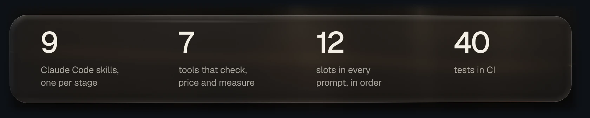</picture></a><a href="skills#gh-light-mode-only"><picture><source media="(max-width: 767px)" srcset="docs/readme/numbers-light-phone.webp 2.835x"><source srcset="docs/readme/numbers-light.webp 2x">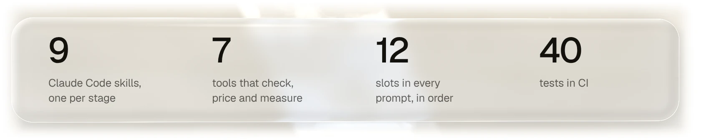</picture></a>

<a href="skills/forge-director/references/budget.md#gh-dark-mode-only"><picture><source media="(max-width: 767px)" srcset="docs/readme/price-dark-phone.webp 2.835x"><source srcset="docs/readme/price-dark.webp 2x">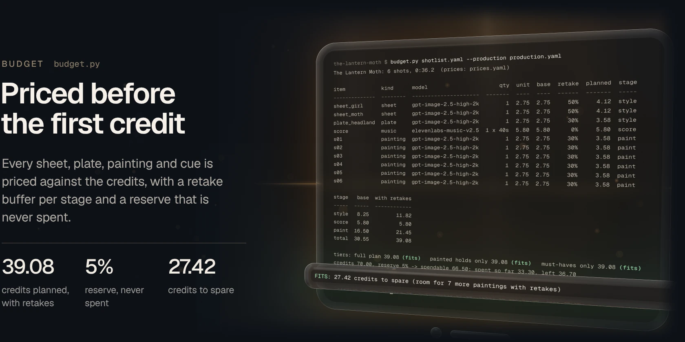</picture></a><a href="skills/forge-director/references/budget.md#gh-light-mode-only"><picture><source media="(max-width: 767px)" srcset="docs/readme/price-light-phone.webp 2.835x"><source srcset="docs/readme/price-light.webp 2x">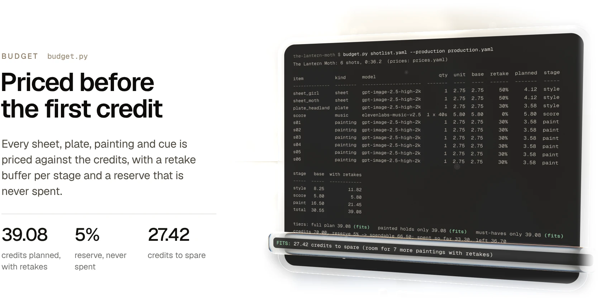</picture></a>

How the plan is priced: [the budget, in full](skills/forge-director/references/budget.md) and [the price table](config/prices.yaml).

<a href="skills/forge-style-lock/references/prompt-grammar.md#gh-dark-mode-only"><picture><source media="(max-width: 767px)" srcset="docs/readme/prompt-dark-phone.webp 2.835x"><source srcset="docs/readme/prompt-dark.webp 2x">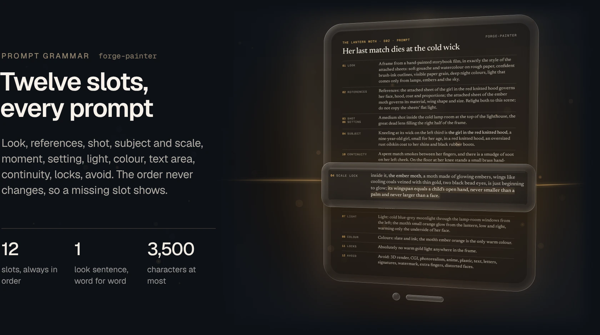</picture></a><a href="skills/forge-style-lock/references/prompt-grammar.md#gh-light-mode-only"><picture><source media="(max-width: 767px)" srcset="docs/readme/prompt-light-phone.webp 2.835x"><source srcset="docs/readme/prompt-light.webp 2x">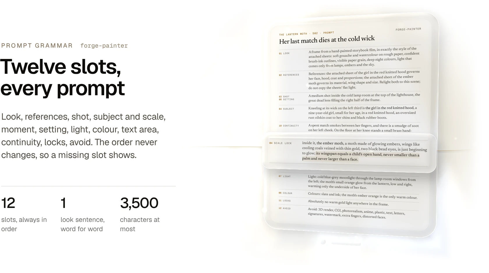</picture></a>

How a prompt is built: [the grammar, slot by slot](skills/forge-style-lock/references/prompt-grammar.md) and [the example&#39;s six prompts](examples/the-lantern-moth/prompts).

<a href="skills/forge-painter/SKILL.md#gh-dark-mode-only"><picture><source media="(max-width: 767px)" srcset="docs/readme/lint-dark-phone.webp 2.835x"><source srcset="docs/readme/lint-dark.webp 2x">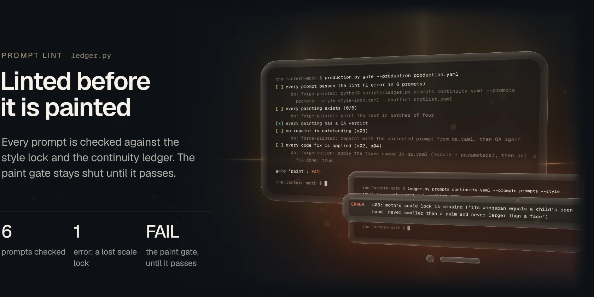</picture></a><a href="skills/forge-painter/SKILL.md#gh-light-mode-only"><picture><source media="(max-width: 767px)" srcset="docs/readme/lint-light-phone.webp 2.835x"><source srcset="docs/readme/lint-light.webp 2x">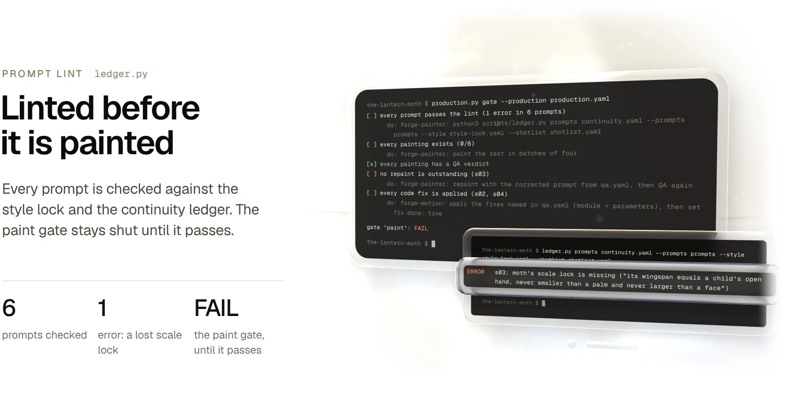</picture></a>

That one missing clause is the difference between a moth the size of a palm and a speck nobody can see. Caught here it costs nothing; caught in frame QA it costs a repaint. [How the painter works](skills/forge-painter/SKILL.md).

<a href="skills/forge-story/references/shotlist-schema.md#gh-dark-mode-only"><picture><source media="(max-width: 767px)" srcset="docs/readme/shots-dark-phone.webp 2.835x"><source srcset="docs/readme/shots-dark.webp 2x">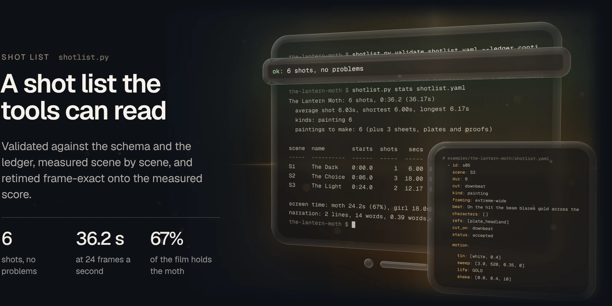</picture></a><a href="skills/forge-story/references/shotlist-schema.md#gh-light-mode-only"><picture><source media="(max-width: 767px)" srcset="docs/readme/shots-light-phone.webp 2.835x"><source srcset="docs/readme/shots-light.webp 2x">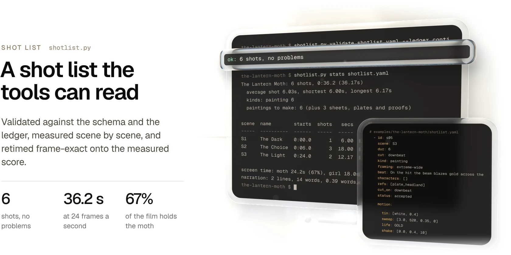</picture></a>

How a shot list is written: [the schema](skills/forge-story/references/shotlist-schema.md) and [the example&#39;s shot list](examples/the-lantern-moth/shotlist.yaml).

## How it works

<a href="skills/forge-director/references/stages.md#gh-dark-mode-only"><picture><source media="(max-width: 767px)" srcset="docs/readme/stages-dark-phone.webp 2.835x"><source srcset="docs/readme/stages-dark.webp 2x">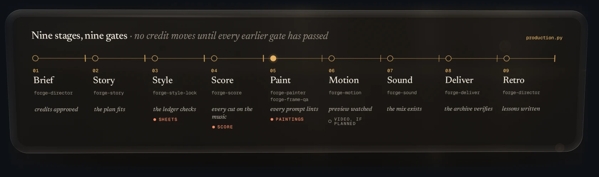</picture></a><a href="skills/forge-director/references/stages.md#gh-light-mode-only"><picture><source media="(max-width: 767px)" srcset="docs/readme/stages-light-phone.webp 2.835x"><source srcset="docs/readme/stages-light.webp 2x">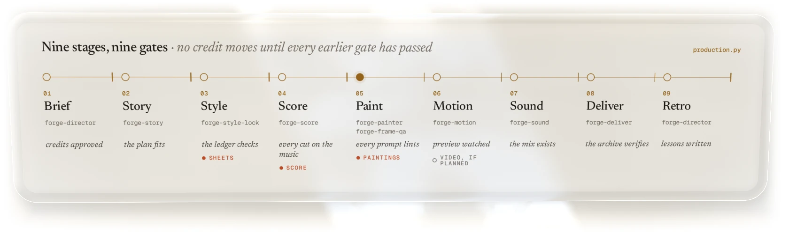</picture></a>

The director runs a production through nine stages. Each stage belongs to one skill and ends at a gate that `production.py` checks, and no credit is spent in a stage until every earlier gate has passed. [The stages, one by one](skills/forge-director/references/stages.md).

### The technique on one page

1. **Story before credits.** A premise becomes a story bible, a timed screenplay and a shot list built on six engines: one relationship, a flaw with a price, a choice that breaks your heart, a twist, a mirror, and one image used twice. Nothing is generated until the story works on paper.
2. **Price the whole film first.** Every sheet, plate, painting, cue and clip is priced against the credit ceiling, with a retake buffer per stage and a reserve that is never spent. If it doesn't fit, cut nice-to-haves, never the story's spine.
3. **One model, one setting, one look.** The model is chosen once per film. A single look sentence goes into every prompt unchanged, with the palette, the colour rules and the forbidden colours.
4. **Sheets before shots.** Every character gets a sheet with a scale bar, and every recurring place a plate, each proven in three real scenes before any shot is painted.
5. **Handles, never names.** Prompts describe people by a fixed handle and anchor ("the girl in the red knitted hood"). A model paints names as text, and named identities get refused.
6. **Twelve slots, every time.** Look, references, shot, subject and scale, moment, setting, light, colour, text area, continuity, locks, avoid. The order never changes, so a missing slot shows.
7. **Lint before you paint.** Every prompt is checked against the style lock and the continuity ledger: the look word for word, every anchor and scale lock, every prop and state, the forbidden-colour clause, the avoid tail and the length.
8. **Batches of four, judged at full size.** Each batch is read at 100% against the sheets before the next is painted, so a fault in batch one is fixed in the prompts of batch two.
9. **Fix in post before you repaint.** Colour, exposure, levels and framing are grades, not paintings. A repaint is for what post can't fix (scale, anatomy, identity), and only once its root cause and its corrected prompt are written down.
10. **When a result gets worse, take away.** Remove the last addition instead of adding more text. Describe what you want positively, and mention every attached reference in the prompt.
11. **Music first, then cut on it.** The score is briefed and measured before the edit (tempo, phrases, hits, silences), and every cut is planned onto it with the story's hits pinned.
12. **Paintings hold; life comes in post.** A painting is held like a film frame and given life in post: fog, particles, light, handwritten words. Paid video is kept for the moments where motion is the story.
13. **Deliver everything, and prove it.** Master, posting copy at -14 LUFS, phone copy, stills and print, each checked for streams, loudness and sync, then an archive with a SHA-256 manifest anyone can re-verify.

The method in full, stage by stage with its rules and gates, is in [docs/method.md](docs/method.md).

### The nine skills

| Skill | What it does |
| --- | --- |
| [forge-director](skills/forge-director/SKILL.md) | Runs the production through its gates, keeps the state file and the credit ledger, prices the plan, and always names the one next action |
| [forge-story](skills/forge-story/SKILL.md) | Premise to story bible, timed screenplay and a shot list sized to the credits |
| [forge-style-lock](skills/forge-style-lock/SKILL.md) | One model and setting, one look, the palette and colour rules, character sheets with scale bars, the prompt grammar |
| [forge-score](skills/forge-score/SKILL.md) | The music brief, then the score measured, ranked against the story's shape and cut on |
| [forge-painter](skills/forge-painter/SKILL.md) | Every shot's prompt in the twelve slots with its continuity anchors, linted, painted in batches of four |
| [forge-frame-qa](skills/forge-frame-qa/SKILL.md) | Every painting at full size, scored on nine criteria: accept, fix in post, or repaint with the root cause and the corrected prompt |
| [forge-motion](skills/forge-motion/SKILL.md) | Each shot's life planned in post instead of credits, and when paid video is worth it |
| [forge-sound](skills/forge-sound/SKILL.md) | Narration timed in film time, sound design keyed to the shots, a mix to delivery loudness |
| [forge-deliver](skills/forge-deliver/SKILL.md) | Every deliverable with exact encode settings, checked, then the archive with its proof |

### The seven tools

They check, price and measure; they generate nothing. `production.py` keeps the state and names the next action. `budget.py` prices the plan. `shotlist.py` validates and retimes the shot list. `beatmap.py` measures the score and plans the cuts. `ledger.py` checks continuity, lints prompts and measures colour. `contact_sheet.py` builds the QA sheet and the 100% crops. `archive.py` hashes and verifies.

### The worked example

[*The Lantern Moth*](examples/the-lantern-moth) is a 36-second film in six shots, written through every stage up to the paint gate. A lighthouse girl gives away the only warm thing she has, a moth made of embers, so the dead lamp can bring a lost boat home. It holds the story bible, the screenplay, the shot list, the style lock, the continuity ledger, the score brief, all six prompts (one missing its scale lock on purpose) and the frame-QA decisions. Every terminal on this page is a tool run on it.

## Quickstart

```bash
git clone https://github.com/gallowforge/filmforge.git && cd filmforge
python3 -m pip install -r requirements.txt     # numpy, Pillow, PyYAML (ffmpeg only for mp3 and m4a input)
./install.sh                                   # the nine skills into ~/.claude/skills, each with its tools
```

Then, in Claude Code:

```text
use forge-director to start a production
```

The director asks for the credit ceiling, makes the production folder from [`templates/`](templates/) and starts the story. `./install.sh --uninstall` removes only the folders it made.

To see the tools work first, run them on the example:

```bash
cd examples/the-lantern-moth && T=../../tools
python3 $T/production.py status production.yaml                  # where the film stands, and the one next action
python3 $T/budget.py shotlist.yaml --production production.yaml  # 39.08 credits planned of 66.50 spendable
python3 $T/ledger.py prompts continuity.yaml --prompts prompts --style style-lock.yaml --shotlist shotlist.yaml
```

## Quality

| Check | What it covers |
| --- | --- |
| 40 tests, under pytest and under a plain runner that needs no pytest | Every tool: the state file and its gates, pricing, the shot list, the beat map, the ledger and the prompt lint, the contact sheet, the archive |
| CI: docs | Every relative link, anchor and image in 43 Markdown files, the README visuals and their generator, size budgets, no machine paths or private addresses, markdownlint, external links |
| CI: tools | Every tool answers `--help`, every Python file compiles, shellcheck, the tests both ways, and the installer into a throwaway home folder and out again |

The README images rebuild from [`docs/readme/src`](docs/readme/src): `terminals.py` runs the tools on the example, and the Glass scenes are rendered from those pages. The image at the top is a loop in which a film goes down the nine stages; every other image is a still.

## FAQ

<details>
<summary><b>Does it need Higgsfield?</b></summary>

No. It was built on Higgsfield, but any image or video model that takes reference images works. The price table lists models and costs, and you can add your own.
</details>

<details>
<summary><b>Why are there no paintings here?</b></summary>

Because the product is the technique. The skills, the prompts and the gates are what make the paintings good, so they are what this repository keeps. The images on this page are its own pages and its tools' output.
</details>

<details>
<summary><b>Why paintings held on screen instead of generated video?</b></summary>

Cost and consistency. A five-second clip costs more than five paintings, often needs rerolls, and rarely matches the shot beside it. A painting held like a film frame, given life in post, costs one image and cuts cleanly. Video is kept for the moments where motion is the story.
</details>

<details>
<summary><b>Does it work without Claude Code?</b></summary>

The tools are plain Python command lines and run anywhere. The skills are the method written for Claude Code, and [docs/method.md](docs/method.md) is the same method for people.
</details>

## Contributing

Issues and pull requests are welcome: run `python3 -m pytest -q tests` and `python3 scripts/check_docs.py` first, and change a rule in its skill and in [docs/method.md](docs/method.md) together.

## Licence

MIT, see [LICENSE](LICENSE).
